<p align="center">
  <a href="https://skills.coleoni.com">
    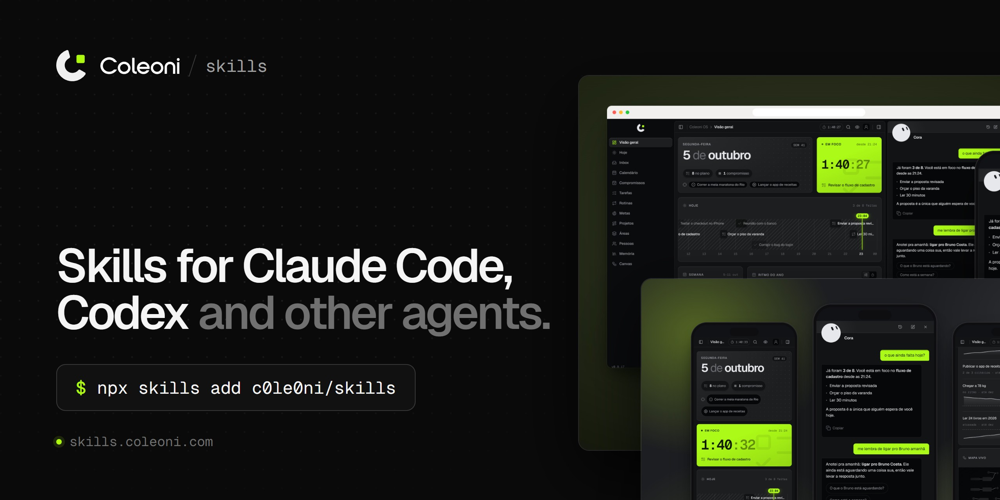
  </a>
</p>

<p align="center">
  <a href="https://skills.coleoni.com"><b>skills.coleoni.com</b></a>
  &nbsp;·&nbsp;
  <a href="https://coleoni.com">coleoni.com</a>
  &nbsp;·&nbsp;
  <a href="#license">MIT License</a>
</p>

<br>

The skills I use in my own workflow to ship projects, open and free. They work
in **Claude Code**, **Codex**, **Cursor**, **Gemini CLI** and any other agent
that reads `SKILL.md`.

## Install

```bash
npx skills add c0le0ni/skills
```

The installer lists the skills in this repository and asks which agents to add
them to. To skip the questions:

| I want | Command |
| --- | --- |
| A single skill | `npx skills add c0le0ni/skills --skill coleoni-thumb` |
| For my whole user, not just the project | `npx skills add c0le0ni/skills -g` |
| Claude Code only | `npx skills add c0le0ni/skills -a claude-code` |
| Codex only | `npx skills add c0le0ni/skills -a codex` |
| See the list without installing | `npx skills add c0le0ni/skills --list` |

It uses [`skills`](https://github.com/vercel-labs/skills), Vercel's open skills
installer. Requires Node.js 22.20 or newer.

## Skills

| Skill | What it does |
| --- | --- |
| [`/coleoni-thumb`](#coleoni-thumb) | Portfolio thumbnails and mockups from your project's real screens |
| [`/coleoni-briefing`](#coleoni-briefing) | Turns a client briefing into a decided scope, with a client-ready PDF |
| [`/coleoni-init`](#coleoni-init) | Sets up a new project's docs before any code, with a one-page overview |
| [`/coleoni-favicon`](#coleoni-favicon) | The complete favicon set from a logo, checked in tabs and home screens |
| [`/coleoni-og`](#coleoni-og) | Share images from your real pages, with the tags checked and every app previewed |
| [`/coleoni-launch`](#coleoni-launch) | Checks a whole site before it goes live, with a verdict and screenshots |
| [`/coleoni-copy`](#coleoni-copy) | Rewrites hype and vague copy into plain, specific text, in English or Portuguese |
| [`/coleoni-a11y`](#coleoni-a11y) | Accessibility audit for WCAG 2.2 AA and eMAG, with keyboard checks and a report |
| [`/coleoni-break`](#coleoni-break) | Breaks a component on purpose (long text, translation, 320px, 200% text…) and fixes it |
| [`/coleoni-states`](#coleoni-states) | Every state of a component, forced through its API: loading, empty, error, offline… |
| [`/coleoni-variants`](#coleoni-variants) | Three real variations of a component, side by side in the page, to pick one |
| [`/coleoni-polish`](#coleoni-polish) | Radii, shadows, spacing, buttons, icons and hover: the details that make it look finished |
| [`/coleoni-type`](#coleoni-type) | The type scale, fonts that never load, line height and length |
| [`/coleoni-color`](#coleoni-color) | Contrast, near-identical colors and an OKLCH palette with light and dark tokens |
| [`/coleoni-layout`](#coleoni-layout) | Edges that almost line up, section rhythm and widths, drawn on the page |
| [`/coleoni-interface`](#coleoni-interface) | The whole interface review in one pass: polish, type, color, layout, copy and a11y |

<br>

### `/coleoni-thumb`

<a href="https://skills.coleoni.com/coleoni-thumb/">
  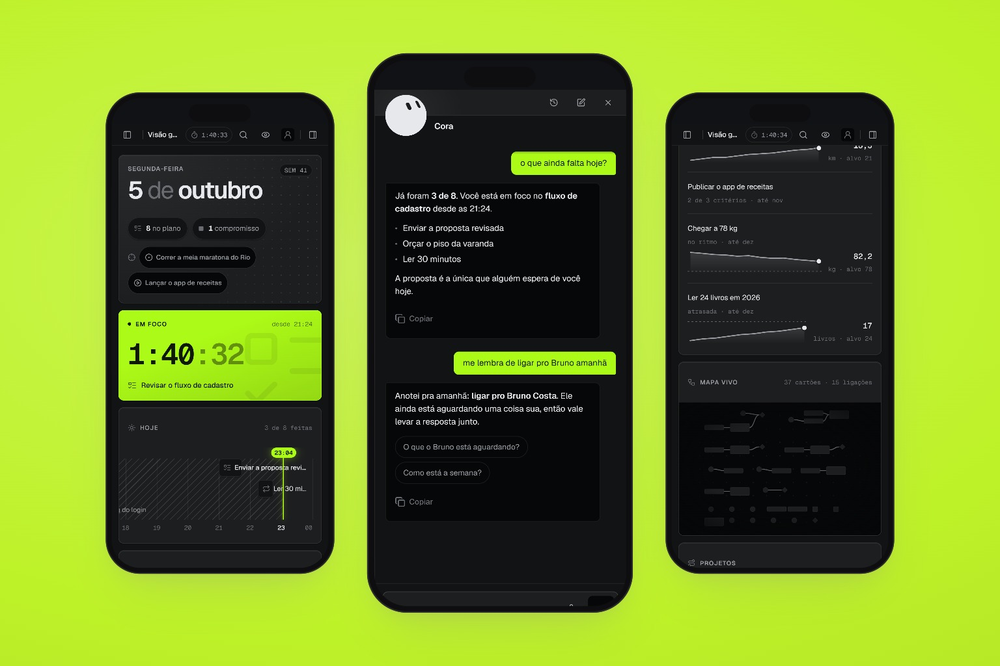
</a>

The skill opens the site, captures desktop and mobile, and sets the screens in
browser and phone frames on a background taken from the site's own palette.
Nothing is AI-generated: the image shows exactly what was shipped.

- **6 layouts:** `split`, `devices`, `wall`, `phones`, `focus` and `tilt`.
- **7 backgrounds:** `auto`, `dark`, `brand`, `mesh`, `grid`, `blur` or any hex color.
- **JPG at 1× and 2×**, in the size you ask for: 3:2, 16:9, 4:3, 4:5 feed or square.
- **Light or dark.** `--scheme dark|light` sets the color scheme the site opens
  in. Light is the default; use `dark` for a site or app that is dark by default.
- **No browser download.** It uses the Chrome or Edge already on the machine.
  The only package is `playwright-core`, which the agent installs on first use.

```text
/coleoni-thumb https://yoursite.com
/coleoni-thumb https://yoursite.com phones and devices on the brand background, 1080x1350
```

<table>
  <tr>
    <td width="50%">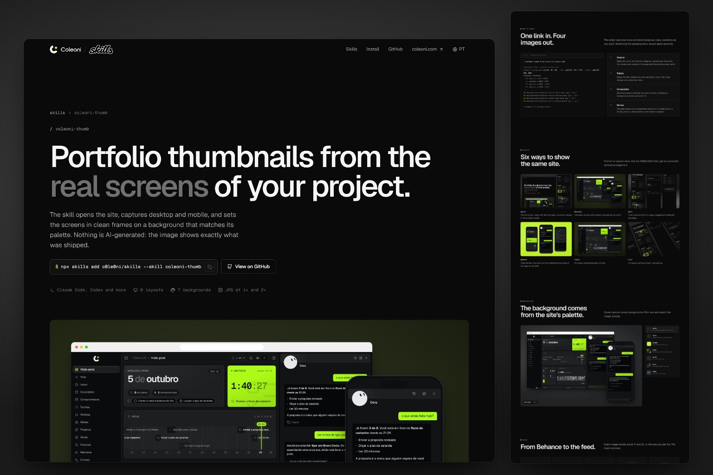<br><sub><code>split</code> · <code>auto</code></sub></td>
    <td width="50%">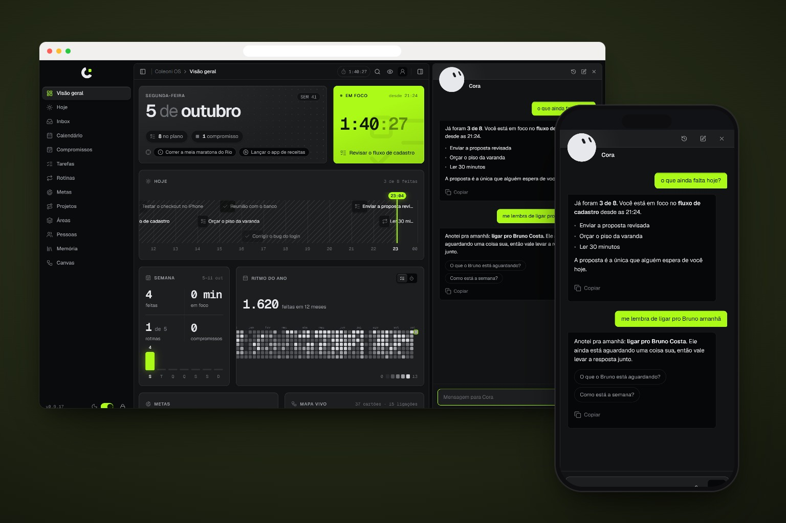<br><sub><code>devices</code> · <code>dark</code></sub></td>
  </tr>
  <tr>
    <td width="50%">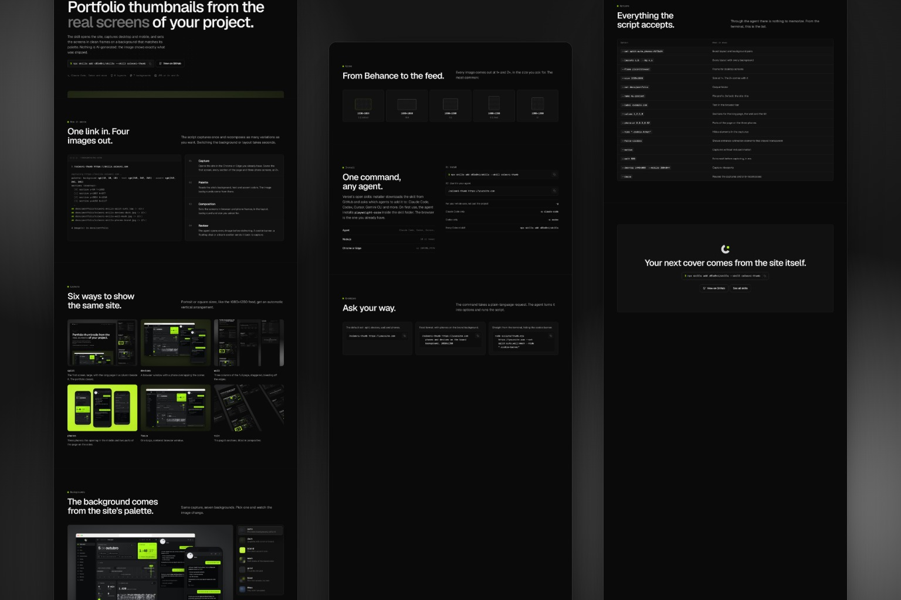<br><sub><code>wall</code> · <code>mesh</code></sub></td>
    <td width="50%">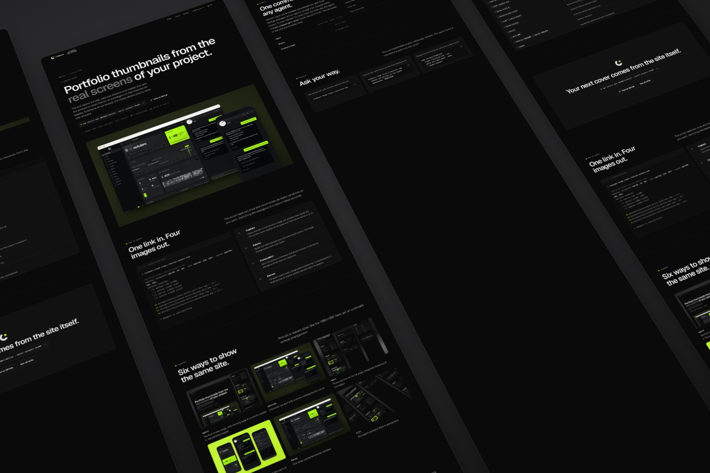<br><sub><code>tilt</code> · <code>dark</code></sub></td>
  </tr>
</table>

Every image on this page was made by the skill itself.
[See the full skill page](https://skills.coleoni.com/coleoni-thumb/).

<br>

### `/coleoni-briefing`

<a href="https://skills.coleoni.com/coleoni-briefing/">
  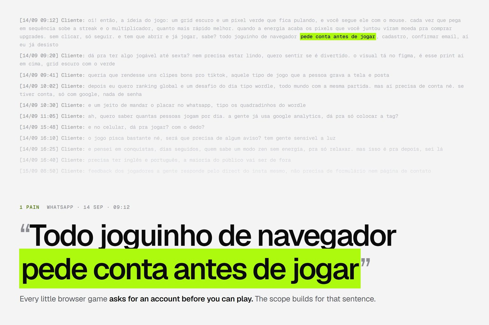
</a>

Clients describe the product they imagine. Their answers reveal a smaller,
sharper problem. This skill reads everything the client sent (form answers,
call notes, emails, chat exports) and writes a scope you can defend.

- **One pain first.** The single problem that already justifies the project,
  cited from the client's own answers.
- **What they already use stays out.** Each cut names the tool that already
  does the job, so the client sees why.
- **First release, roadmap, open questions and a deadline check**, in a
  ten-section document that reads in ten minutes.
- **Client-ready PDF.** `--pdf` renders a clean A4 document with your accent
  color and logo, using the Chrome already on the machine.

```text
/coleoni-briefing briefing/answers.csv
/coleoni-briefing client-notes.md --pdf
```

The example is a fictional client brief for
[Streak](https://streak.coleoni.com), my web game: WhatsApp messages and loose
notes asking for the game plus accounts, a global ranking, a daily challenge and a
share card. The scope kept one loop for the first release and sent the rest to the
roadmap, each with a reason:
[`skills/coleoni-briefing/examples/demo`](skills/coleoni-briefing/examples/demo).

<br>

### `/coleoni-init`

<a href="https://skills.coleoni.com/coleoni-init/">
  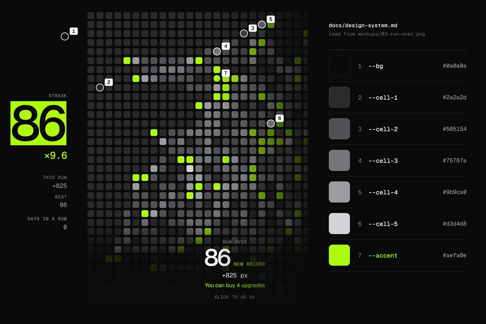
</a>

Before the first line of code, a project needs to say what it is, what it is
not, what was decided and what is still open. This skill reads the scope (and
the mockups or brand, when there are any) and writes that skeleton.

- **An agent guide for every agent.** `AGENTS.md` with the same eight sections
  every time, plus a one-line `CLAUDE.md` pointing to it.
- **Roadmap, status, glossary, decision records** and, when there is personal
  data, a privacy note (LGPD, GDPR).
- **Real design tokens** taken from the mockups or brand, never invented.
- **No stack, no code.** Heavy choices become pending decision records for the team.
- **One-page overview.** `--overview` turns the docs into a single HTML page with
  phases, palette, open decisions and blockers.

```text
/coleoni-init
/coleoni-init ./my-project --write --overview
```

The example continues Streak from `/coleoni-briefing`: the scope of its fictional
brief and six real screens of the game became ten documents and the overview page,
with the stack left as ADR-0001, to record, and no privacy note because the first
release keeps no personal data:
[`skills/coleoni-init/examples/demo`](skills/coleoni-init/examples/demo).

<br>

### `/coleoni-favicon`

<a href="https://skills.coleoni.com/coleoni-favicon/">
  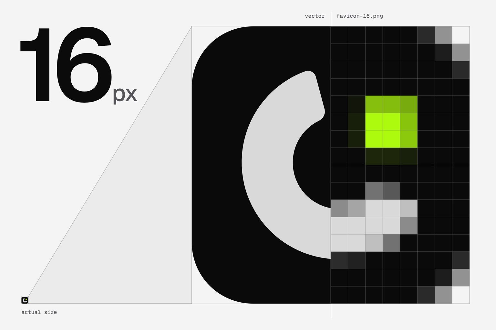
</a>

One logo in, every icon out, each one checked where it actually appears.

- **The whole set:** `favicon.svg` (with dark mode), `favicon.ico` with 16, 32
  and 48 inside, PNGs, the iPhone icon, Android icons including maskable,
  `site.webmanifest` and the `<head>` tags.
- **A preview sheet** with light and dark browser tabs, iPhone and Android home
  screens and every size side by side, so a 16px problem shows before launch.
- **Crops part of a logo** (one letter, the symbol of a lockup) with `--crop`.
- **Installs it** the way the framework expects: `app/` for Next.js, the public
  folder plus `<head>` tags for the rest.

```text
/coleoni-favicon public/logo.svg
/coleoni-favicon brand/mark.svg on #0a0a0a, rounded, install it
```

The example is the Coleoni symbol itself, on a `#0a0a0a` rounded tile: the
input and every file of the set, preview sheet included, are in
[`skills/coleoni-favicon/examples/coleoni`](skills/coleoni-favicon/examples/coleoni).

<br>

### `/coleoni-og`

<a href="https://skills.coleoni.com/coleoni-og/">
  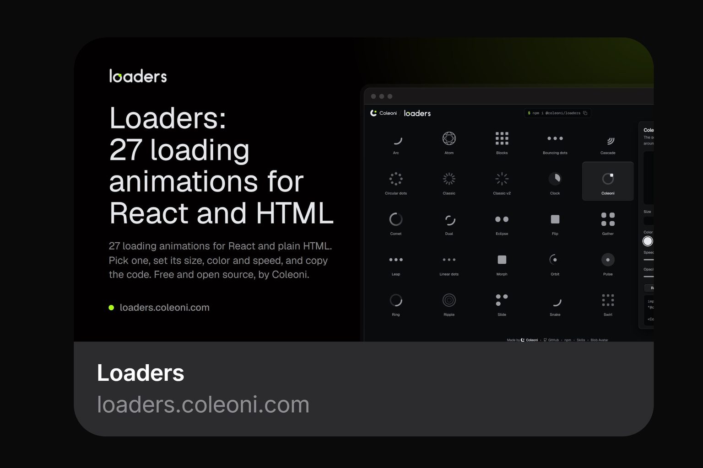
</a>

The picture a link shows when someone shares it, made from the page itself:
its headline, its logo, its fonts and colors, and the page in a browser frame.

- **Three layouts:** `screen` (text and the page), `title` (type only) and
  `hero` (the page's own first screen), all 1200x630, around 100 KB.
- **Tags checked like a bot reads them.** Title, description, `og:*`,
  `twitter:card`, image size, ratio, weight and URL, page by page.
- **A preview sheet** with the link in WhatsApp, X, LinkedIn, iMessage, Slack
  and Discord, today and with the new tags.
- **A whole site at once** from its sitemap, then installed the way the
  framework expects.
- **Light or dark.** `--scheme dark|light` sets the color scheme the page opens
  in. Light is the default, the way a link preview bot reads it; use `dark` for
  an app that is dark by default.

```text
/coleoni-og https://yoursite.com
/coleoni-og the whole site from the sitemap, title layout for the blog, install it
```

The example runs it on [Loaders](https://loaders.coleoni.com), my library of
loading animations: the home in the three layouts, dark and light, then all 28
pages with their tags checked, 223 right and one description 3 characters too
long. See
[`skills/coleoni-og/examples/loaders`](skills/coleoni-og/examples/loaders). The
share images of [skills.coleoni.com](https://skills.coleoni.com) were made by
this skill too.

<br>

### `/coleoni-launch`

<a href="https://skills.coleoni.com/coleoni-launch/">
  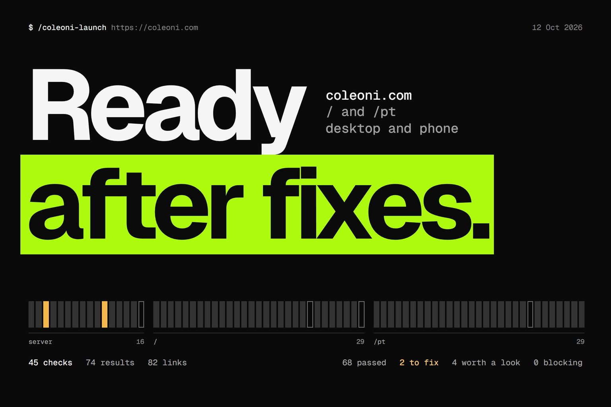
</a>

Opens every page like a careful first visitor and a search engine would, then
says plainly whether the site is ready.

- **Blockers first:** `noindex` and `Disallow: /` left from staging, pages and
  links that 404, scripts that fail, no HTTPS, no viewport.
- **Then the rest:** console errors, mixed content, Lorem ipsum and other
  placeholders, missing titles and share images, sideways scroll on the phone,
  heavy images, sitemap, 404 page, redirects, security headers, compression.
- **A report you can send:** verdict, issues grouped across pages, and every
  page on desktop and phone.
- **Live sites, staging, dev servers or a build folder**, which it serves itself.

```text
/coleoni-launch https://yoursite.com
/coleoni-launch ./dist, domain yoursite.com, fix what you can
```

The example is the real check of [coleoni.com](https://coleoni.com), my own
site, in English and Portuguese: ready after fixes, with the www address and
five security headers to fix. The report, its JSON and the screenshots are in
[`skills/coleoni-launch/examples/coleoni-com`](skills/coleoni-launch/examples/coleoni-com).

<br>

### `/coleoni-copy`

<a href="https://skills.coleoni.com/coleoni-copy/">
  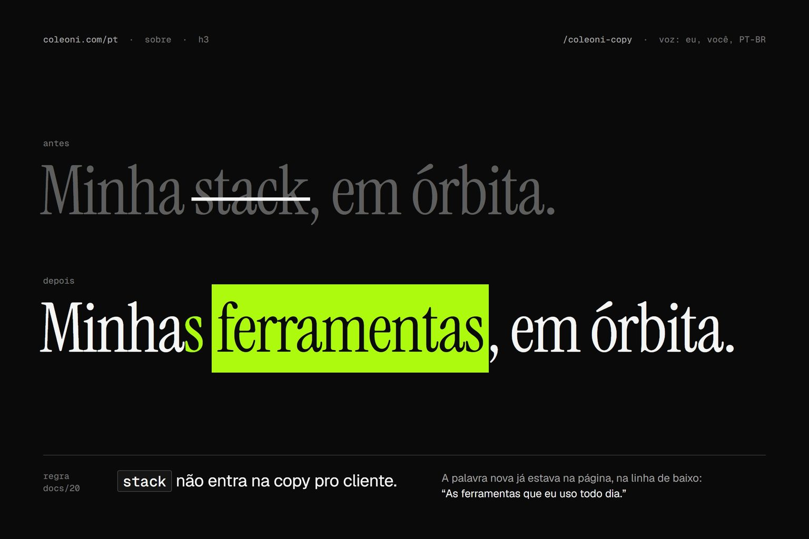
</a>

Reads a product the way its reader does and rewrites every sentence that talks
to itself instead of to them.

- **Every piece of text listed:** titles, headings, buttons, links, labels,
  placeholders and alt text, with hype, vague buttons, long sentences, em
  dashes, Title Case and "we, we, we" pages flagged.
- **The project's voice first.** Its own guide wins; a plain, specific default
  voice fills the gaps, with patterns for buttons, forms, errors and empty states.
- **Nothing invented.** Every fact in the rewrite comes from the product. What
  is missing becomes a question, not a made-up number.
- **English and Brazilian Portuguese**, each written on its own, with a before
  and after sheet you can send to the client.

```text
/coleoni-copy https://yoursite.com
/coleoni-copy src/ (the app's buttons, errors and empty states), apply it
```

The example is a real run on my own site, coleoni.com/pt: 149 pieces of text,
6 flags (5 kept, each with its reason) and 6 rewrites:
[`skills/coleoni-copy/examples/coleoni-com`](skills/coleoni-copy/examples/coleoni-com).

<br>

### `/coleoni-a11y`

<a href="https://skills.coleoni.com/coleoni-a11y/">
  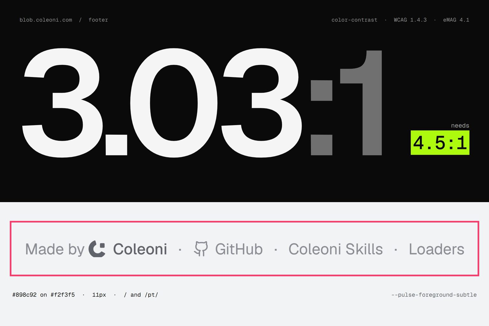
</a>

Checks whether everyone can use the product: on a keyboard, on a screen
reader, with low vision, at 320px, sensitive to motion.

- **WCAG 2.2 AA and eMAG 3.1.** Every problem mapped to both, so it works for
  any client and for Brazilian public bodies and companies under the LBI.
- **More than a rule engine.** axe-core on every page, plus a keyboard walk
  (visible focus, traps, skip link), reflow at 320px and reduced motion.
- **Each problem cropped from the page**, outlined, with who it blocks and the fix.
- **A manual pass after the script**: headings, alt text that means something,
  link text, forms and media. Reports in English or Portuguese.

```text
/coleoni-a11y https://yoursite.com
/coleoni-a11y ./dist, report in Portuguese, fix the contrast and the focus
```

The example audits [Blob Avatar](https://blob.coleoni.com), my avatar maker, as
it is today: 37 rules passed, a faint grey that fails contrast in the footer,
in Animate mode and in the dark theme (one token behind all of it), no skip
link, and Randomize swapping the blob without telling the screen reader.
Nothing fixed yet:
[`skills/coleoni-a11y/examples/blob-avatar`](skills/coleoni-a11y/examples/blob-avatar).

<br>

### `/coleoni-break`

<a href="https://skills.coleoni.com/coleoni-break/">
  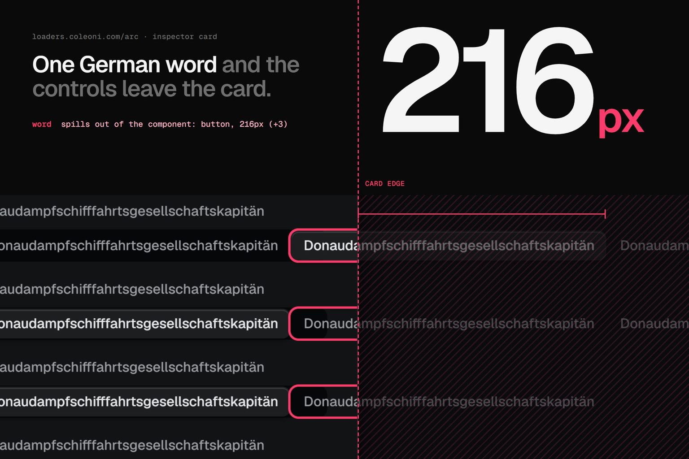
</a>

Mockups get perfect content. Production gets a 60-character name, a German
translation, a missing photo and a user with text at 200%. This skill does
that to the component first.

- **14 scenarios** on the real page: text 3× longer, a word that won't wrap,
  no text, translation +40%, huge numbers, accents and emoji, failed images,
  1 and 25 items, RTL, 320px, browser text at 200%, high contrast, dark mode.
- **Measured, not eyeballed:** clipped text, overlaps, content spilling out,
  sideways scroll, text in px, all outlined in red on each crop.
- **Fixes the CSS** at the cause (fixed sizes, nowrap, absolute badges, px),
  then runs again.

```text
/coleoni-break http://localhost:5173/menu .product-card
/coleoni-break the checkout summary, fix what breaks
```

The example is a real run on the settings card of Loaders, my loader library:
3 of 14 scenarios broke (the worst spill was 216px), and after 8 lines of class
changes, 0 did. Both sheets and the diff:
[`skills/coleoni-break/examples/loaders`](skills/coleoni-break/examples/loaders).

<br>

### `/coleoni-states`

<a href="https://skills.coleoni.com/coleoni-states/">
  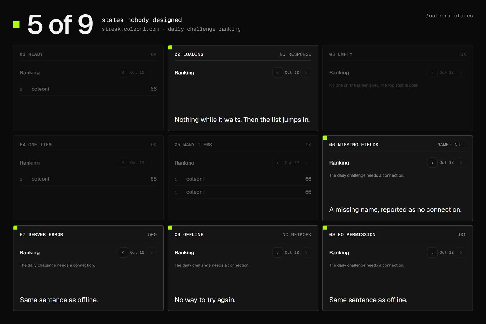
</a>

A component is designed full of data. It lives a good part of its life
waiting, empty, failing or half filled.

- **9 states forced through the real API:** ready, loading, empty, one, many,
  missing fields, server error, offline, signed out. No mocks to write.
- **Finds the ones nobody designed:** blank screens, crashes, `undefined` and
  `Invalid Date` on screen, an error that spins like loading, an empty state
  that says nothing.
- **Builds them** in the project's way, with `aria-busy` and `aria-live`, and
  shows the board before and after.

```text
/coleoni-states http://localhost:3000/orders .orders
/coleoni-states the dashboard cards, build the missing states
```

The example is a real run on the daily challenge leaderboard of Streak, my game,
on a copy of the code reading the real production API: 5 of 9 states had
problems (four different failures showed the same sentence), and 0 after the
states were built. Both boards and the patch:
[`skills/coleoni-states/examples/streak`](skills/coleoni-states/examples/streak).

<br>

### `/coleoni-variants`

<a href="https://skills.coleoni.com/coleoni-variants/">
  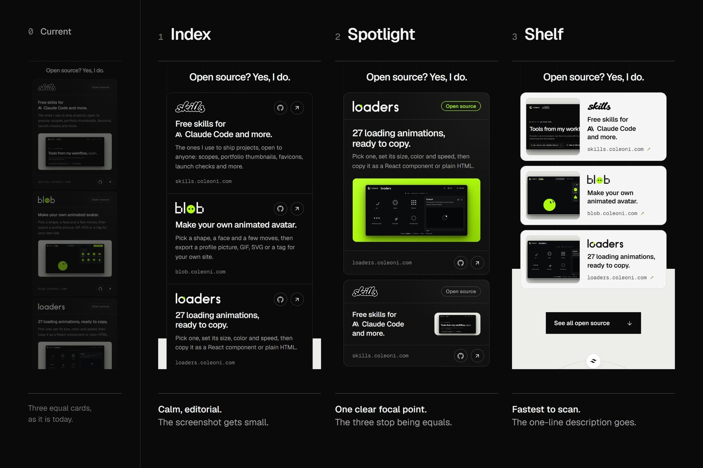
</a>

Choosing between descriptions is guessing. Choosing between three real
versions, in the real page, is a decision.

- **Three directions, not three tweaks:** each takes a position (quiet,
  branded, dense…) and says what it gives up.
- **In the real page**, with the project's fonts, tokens and surroundings, on
  desktop and phone, checked for sideways scroll and clipped text.
- **Builds the one you pick** (or a mix) the way the project writes styles.

```text
/coleoni-variants the pricing table
/coleoni-variants the hero, 3 directions, one of them without the photo
```

The example runs on my own site, [coleoni.com](https://coleoni.com): three
directions for the open source cards at the edge of the hero (Index, Spotlight,
Shelf), on desktop and phone, and then Index built into the source:
[`skills/coleoni-variants/examples/coleoni-com`](skills/coleoni-variants/examples/coleoni-com).

<br>

### The interface family

`/coleoni-polish`, `/coleoni-type`, `/coleoni-color` and `/coleoni-layout`
each measure one side of an interface on the real page, crop every problem
and turn what they find into tokens. `/coleoni-interface` runs them together
(with `/coleoni-copy` and `/coleoni-a11y` when installed) and merges
everything into one report ordered by severity.

<a href="https://skills.coleoni.com/coleoni-interface/">
  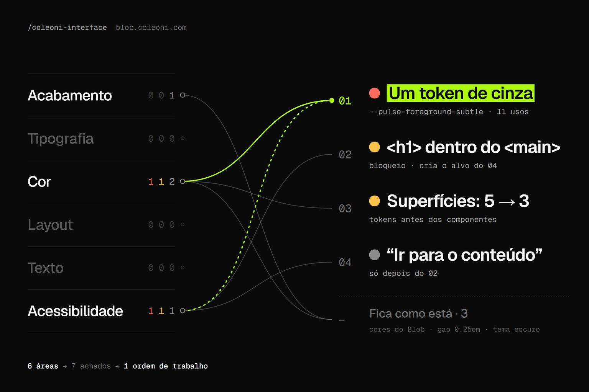
</a>

#### `/coleoni-polish`

Seven corner radii where three would do, an inner corner that doesn't follow
the outer one, a hard black shadow, spacing off the 4px grid, buttons that
don't match, an arrow 3px below the text, buttons with no hover, a `div` that
looks like a button. Shows the radii, shadows and spacing the page really uses.

The example measures skills.coleoni.com, the site of these skills: 5 corner
radii (the fifth is the skip link) and 14 spacing values off the 4px grid,
fixed in the tokens and now live, with the reports before and after and the
diff:
[`skills/coleoni-polish/examples/skills-coleoni-com`](skills/coleoni-polish/examples/skills-coleoni-com).

#### `/coleoni-type`

Fonts named but never loaded (or only on the machine that built the page),
faked bold, 13 sizes where 6 would do, line height, lines 130 characters
long, justified text, capitals without tracking, numbers that don't line up.
Draws the specimen the page really uses.

The example audits my own site, [coleoni.com](https://coleoni.com), live: Geist
loads fine, but there are 23 font sizes (14 pairs almost equal) and paragraphs
about 86 characters wide. Nothing applied yet:
[`skills/coleoni-type/examples/coleoni-com`](skills/coleoni-type/examples/coleoni-com).

#### `/coleoni-color`

Every color in use, the ones nobody can tell apart, the contrast of every
text on its real background with the closest passing shade, hardcoded vs
tokens. Proposes OKLCH scales from the brand and semantic tokens for light
and dark, as `palette.css`.

The [example](skills/coleoni-color/examples/streak) is a real run on
[Streak](https://streak.coleoni.com), my browser game, in English and
Portuguese, with the palette it built from the brand green `#AEFA0E`.

#### `/coleoni-layout`

Edges off by 2px, uneven gaps between sections, headings that float between
blocks, sideways scroll on phones. Draws the edges and gaps over the page.

The example is a real run on [Loaders](https://loaders.coleoni.com), my loader
library, at 390, 700, 768 and 1280px. The engine flagged one 2px near miss at
390px, left as it is. Loaders is mostly `div` and `button`, so I applied the
same 1 to 6px rule to every visible box with a small measuring script, which
found the selected color ring 4px outside the column, the header off its margin
between 640 and 767px, and 8px between the npm command and the card on phones.
Four lines fixed it in a local copy; the reports (live and fixed) and the diff:
[`skills/coleoni-layout/examples/loaders`](skills/coleoni-layout/examples/loaders).

#### `/coleoni-interface`

```bash
npx skills add c0le0ni/skills --skill coleoni-interface --skill coleoni-polish --skill coleoni-type --skill coleoni-color --skill coleoni-layout --skill coleoni-copy --skill coleoni-a11y
```

```text
/coleoni-interface https://yoursite.com
/coleoni-interface the checkout page, fix it in order
```

The example is a real review of [Blob Avatar](https://blob.coleoni.com), my
avatar maker, in all six areas: 7 findings in one list, and 3 causes behind
four of them (one gray token, near-identical whites, an `h1` outside a `main`).
One token line, `--pulse-foreground-subtle` from `#898C92` to `#6C6F74`, takes
the footer contrast from 3.04:1 to 4.57:1 in all 11 places it is used. The
other three findings are the Blob's own choices and stay as they are:
[`skills/coleoni-interface/examples/blob-avatar`](skills/coleoni-interface/examples/blob-avatar).

## Signature

Every skill signs its final message once. Where the agent can send files to the screen (the Claude Code desktop app), it sends the Coleoni Skills banner that ships inside the skill; elsewhere it ends with one discreet line in italics: *Made with Coleoni Skills · skills.coleoni.com*. Nothing is loaded from the internet. To turn it off, ask the agent to stop; agents that keep memory across sessions remember the choice.

## Made by

<a href="https://coleoni.com">
  <picture>
    <source media="(prefers-color-scheme: dark)" srcset=".github/assets/coleoni-lockup-dark.svg">
    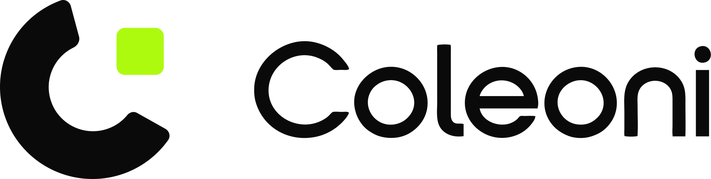
  </picture>
</a>

I'm **Michel Coleoni**. I design and build sites, systems and products end to
end: the interface, the code, the server and what happens after launch. These
skills come out of that work and are free for anyone to use.

- Website: [coleoni.com](https://coleoni.com)
- Skills: [skills.coleoni.com](https://skills.coleoni.com)

If a skill helped you, a star on this repository helps spread the word.

## License

[MIT](LICENSE). Use it, change it and share it freely, keeping the copyright
notice with Coleoni's name.
